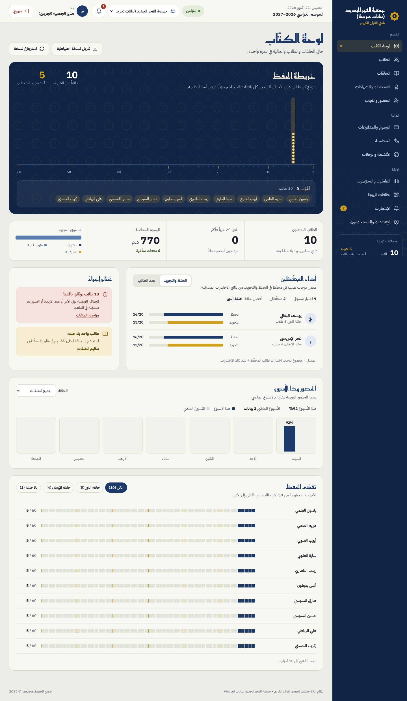
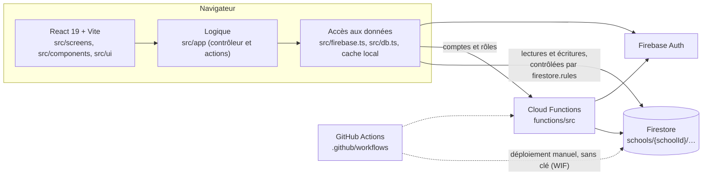

# لوحة الكتّاب — gestion d'écoles coraniques

Application web de gestion des écoles coraniques (kuttab) de l'association
« جمعية الفجر الجديد », en arabe (de droite à gauche). Elle couvre la vie de
l'école au quotidien : élèves et halaqas, présences, suivi du hifz, examens et
attestations, cotisations et paiements, comptabilité, personnel et salaires,
activités, cartes d'identité avec QR code, notifications, comptes et rôles.

Plusieurs écoles partagent la même plateforme, chacune dans un espace
cloisonné. Les données de production sont **réelles** : élèves mineurs,
paiements, salaires.

<p align="center">
  
</p>

## Qui l'utilise

| Rôle (valeur en base) | Ce qu'il fait |
|---|---|
| Directeur (`مدير`) | pilote l'école, gère les comptes et les paramètres |
| Administratif (`إداري`) | inscriptions, encaissements, comptabilité, personnel |
| Encadrant (`مؤطر`), enseignant (`مدرس`) | appel, hifz, examens, activités |
| Bénévole, entretien, autre (`متطوع`, `عامل نظافة / صيانة`, `أخرى`) | accès réduit |
| Parent (`ولي أمر`), élève (`طالب`) | suivi de leurs propres enfants ou de leur propre dossier |
| Super-admin de la plateforme | crée les écoles et leurs directeurs |

Les valeurs des rôles restent en arabe : ce sont des clés de données.

## Démarrer en local

Prérequis : Node 22, Java 21 (émulateur Firestore), npm. Tout tourne sur les
**émulateurs Firebase** avec des données fictives : aucun service réel n'est
appelé (projet `demo-quran-school`).

```bash
npm ci && npm ci --prefix functions
npm run emulators          # auth 9099, firestore 8080, functions 5001, hosting 5000, interface 4000
npm run seed:emulator      # dans un autre terminal : 2 écoles fictives et leurs comptes de démo
npm run dev                # http://localhost:3000
```

Comptes de démonstration : `tests/e2e/helpers.ts` (fictifs, émulateurs seulement).

Vérifications à garder vertes :

```bash
npm run lint && npm run lint:functions   # TypeScript
npm test                                 # tests unitaires
npm run test:rules                       # règles Firestore, migration, Cloud Functions
npm run test:e2e                         # parcours dans Chromium, sous la CSP de production
npm run build                            # build de production
```

Toutes les commandes et leurs pièges : [`CLAUDE.md`](CLAUDE.md).

## Architecture



- **Données** : tout est rangé sous `schools/{schoolId}/…` (14 collections et
  les paramètres), avec le champ `schoolId` dans chaque document. Les comptes
  sont dans `users/{uid}`, les appartenances dans
  `schools/{id}/members/{uid}` (rôle, liens vers les élèves ou la fiche du
  personnel). Les fiches RH (salaire, CIN) sont à part, dans `staffPrivate`,
  réservées au bureau.
- **Sécurité** : `firestore.rules` est le seul contrôle côté serveur pour les
  données métier. Les comptes, rôles et écoles ne s'écrivent que par les
  Cloud Functions.
- **Mise en production** : uniquement par les workflows GitHub, déclenchés à la
  main, après accord du propriétaire. Personne ne déploie depuis son poste.

| Dossier | Contenu |
|---|---|
| `src/screens/`, `src/components/` | écrans et fenêtres |
| `src/ui/`, `src/shell/` | composants de la charte, cadre (menu, barre du haut) |
| `src/app/` | contrôleur de l'app et actions par domaine |
| `src/firebase.ts`, `src/db.ts`, `src/cache/` | accès à Firestore et cache local cloisonné par école |
| `src/session/`, `src/school/`, `src/security/` | connexion, école active, règles de sécurité côté client |
| `src/print/` | gabarits d'impression (reçus, attestations, cartes) |
| `functions/` | Cloud Functions (comptes, rôles, écoles, sauvegardes) |
| `firestore.rules` | règles d'accès multi-écoles |
| `scripts/` | scripts d'administration et de migration (simulation par défaut) |
| `tests/` | tests unitaires, émulateurs, Hosting, bout en bout |
| `design/` | maquette de référence de la charte (pas du code de l'app) |
| `docs/` | documentation : voir [`docs/README.md`](docs/README.md) |

## Règles à ne jamais enfreindre

Elles sont détaillées dans [`CLAUDE.md`](CLAUDE.md) et valent pour tout le
monde, humains et agents :

- aucune commande vers la production depuis un poste ou un conteneur ;
- développer et tester sur les émulateurs ;
- aucun secret, export ni fichier de mots de passe dans le dépôt ;
- une branche et une PR par sujet, jamais de push sur `main` ni `release/lot0` ;
- toute modification de `firestore.rules` s'accompagne de tests ;
- toute décision structurante est consignée dans [`docs/DECISIONS.md`](docs/DECISIONS.md).

## Où en est le projet

- **En production** : le « Lot 0 » (une seule école, connexion sécurisée par
  Firebase Auth, plus aucun mot de passe en base).
- **Prêt sur `main`** : la version multi-écoles et la nouvelle charte, testées
  sur le projet de recette.
- **Prochaine étape** : la bascule de la production vers la version
  multi-écoles, puis l'arrivée de la deuxième école.

Suivi : [`docs/PLAN.md`](docs/PLAN.md) et [`docs/PASSATION.md`](docs/PASSATION.md).

## Historique

L'application a été générée au départ avec Google AI Studio : une interface
soignée, mais une structure à reprendre (mots de passe stockés en base, accès
ouverts, une seule école). Mélik ([@MikoOwO](https://github.com/MikoOwO)) a mené
toute la reprise, avec Claude Code :

- analyse et plan de reprise ;
- sécurisation de la connexion (Lot 0) ;
- passage au multi-écoles et règles d'accès par rôle ;
- Cloud Functions de gestion des comptes ;
- découpage de l'application ;
- impressions sûres, sauvegardes, nouvelle charte ;
- chaîne de mise en prod sans clé ;
- tests à chaque étape.

Le raisonnement derrière chaque choix est dans [`docs/DECISIONS.md`](docs/DECISIONS.md).

Le dépôt est privé : application interne de l'association.
