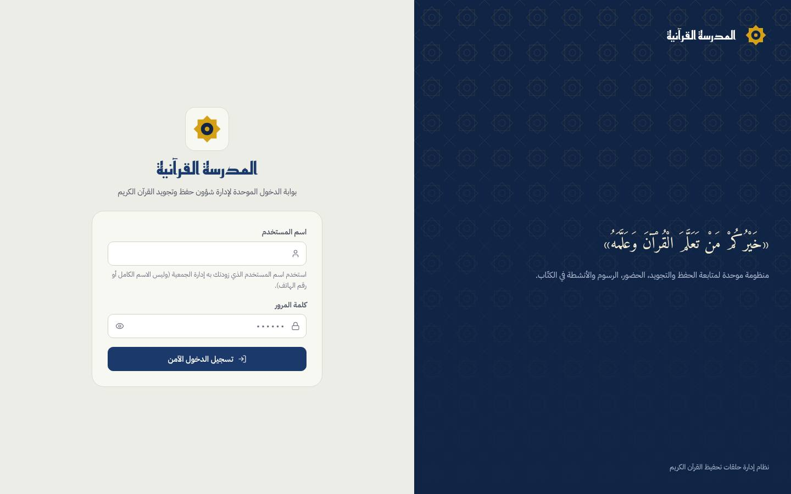
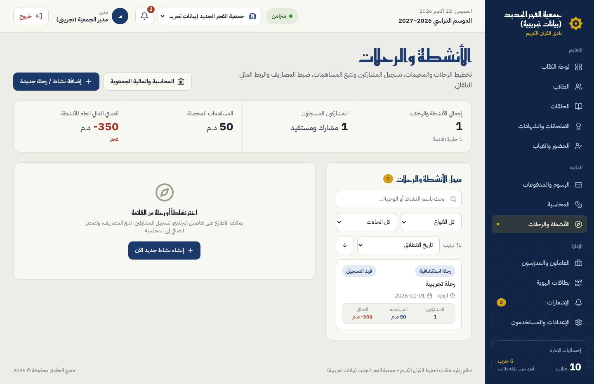
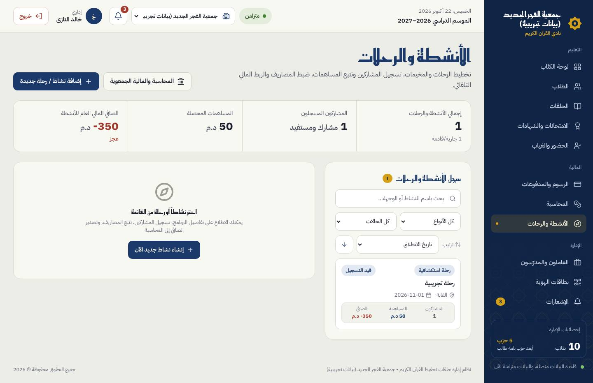
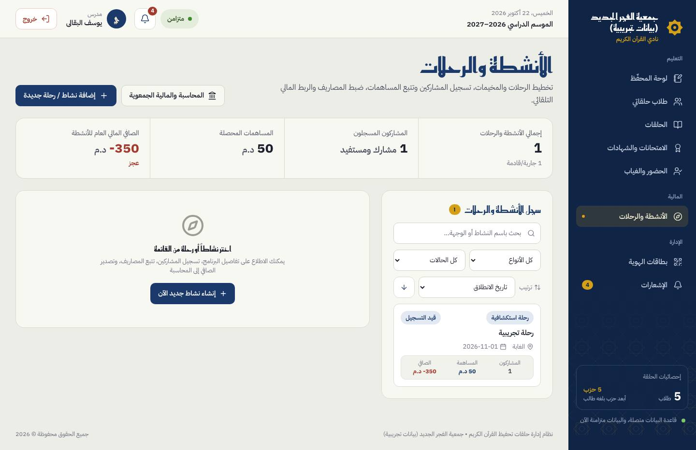
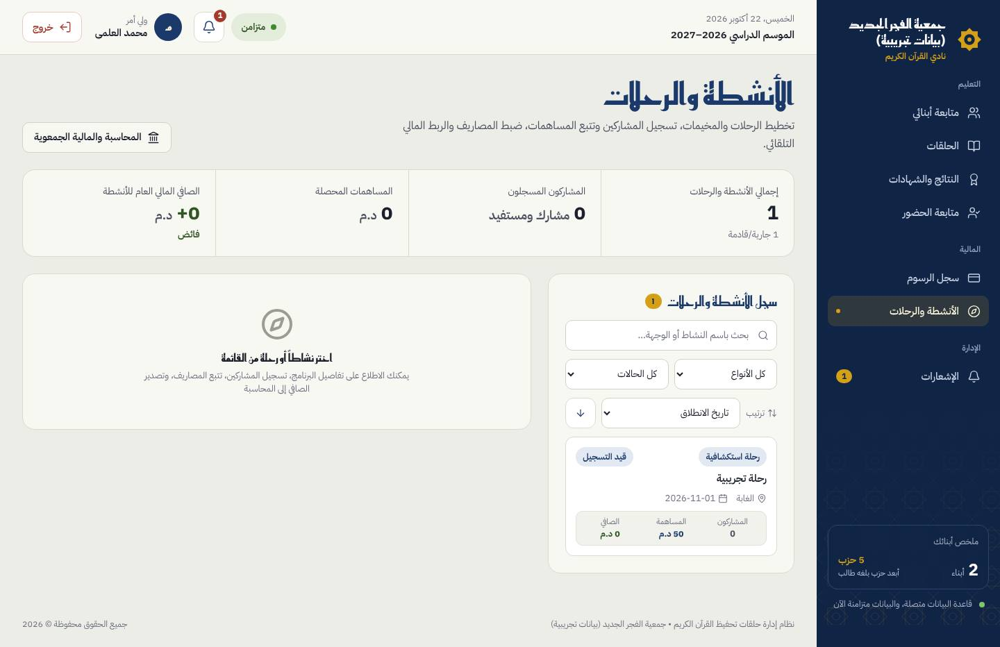
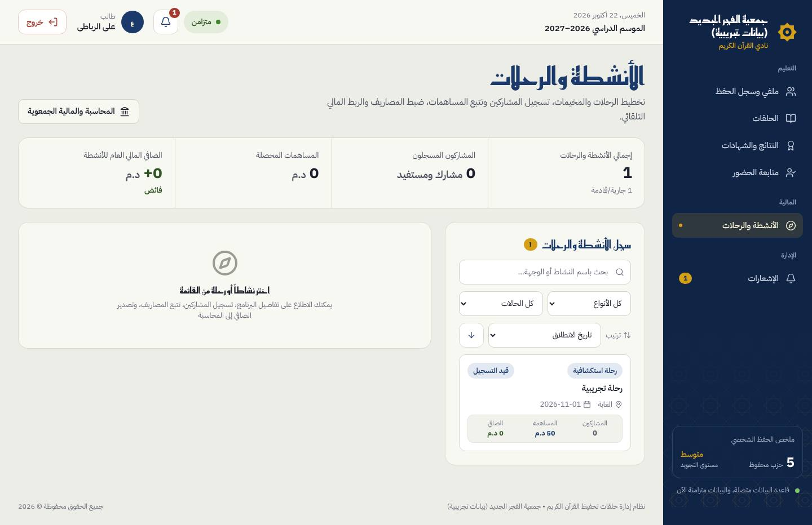
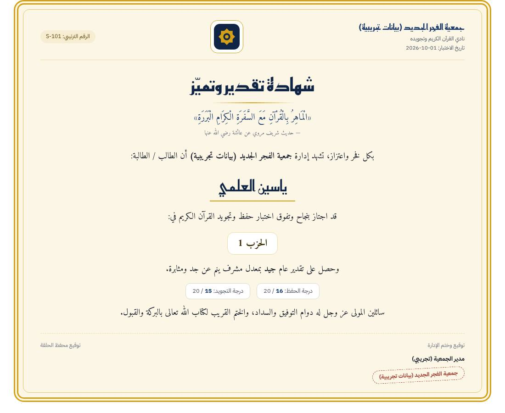

# Nouveau design : avancement et captures

Branche `feat/design` (depuis `refactor/decoupage-app`). Charte d'après `design/Main.dc.html`, `Nav.dc.html`, `Topbar.dc.html` ;
décisions et écarts : `docs/DECISIONS.md` (D56 à D62). Suivi détaillé : `docs/progress/ETAPE-2-design.md`.

Captures produites avec des **données fictives** sur les émulateurs (`npm run capture:screens`, `tests/e2e/print.spec.ts`),
à 1440 px (« bureau ») et 390 px (« mobile ») ; « avant » = `refactor/decoupage-app` (identique à l'application d'origine),
« après » = `feat/design`. Les fenêtres ne sont capturées qu'en bureau.

## État par écran

| Écran | État |
|---|---|
| Cadre : menu groupé (التعليم / المالية / الإدارة), barre du haut, sélecteur d'école, menu mobile | fait |
| Tableau de bord (carte des 60 أحزاب, KPI, أداء المحفّظين, تحتاج إجراءً, الحضور, تقدّم الحفظ) | fait |
| Élèves (liste, dossier, carte, rapport IA, inscription) | fait |
| Personnel (en-tête, indicateurs, filtres, liste, badge, fenêtres) | fait |
| Halaqas, présences (scan QR, relevé mensuel), examens et attestations | fait |
| Frais et reçus, comptabilité (4 sections, fenêtres, rapport), activités | fait |
| Notifications, cartes QR (laboratoire), paramètres et utilisateurs | fait |
| Connexion, attente de session, choix et création d'école, profil, portail enseignant | fait |
| Impressions (reçu, attestation, rapports, cartes, relevé de présence) sans CDN ni script | fait |
| Mobile 360 px sans défilement horizontal (test `tests/e2e/mobile.spec.ts`) | fait |

## Captures

### Connexion

| Écran | Avant | Après |
|---|---|---|
| `connexion` | [1440](captures/avant/connexion/connexion-bureau.jpg) · [390](captures/avant/connexion/connexion-mobile.jpg) | [1440](captures/apres/connexion/connexion-bureau.jpg) · [390](captures/apres/connexion/connexion-mobile.jpg) |
| `mot-de-passe-impose` | [1440](captures/avant/connexion/mot-de-passe-impose-bureau.jpg) · [390](captures/avant/connexion/mot-de-passe-impose-mobile.jpg) | [1440](captures/apres/connexion/mot-de-passe-impose-bureau.jpg) · [390](captures/apres/connexion/mot-de-passe-impose-mobile.jpg) |

### Directeur (مدير)

| Écran | Avant | Après |
|---|---|---|
| `activities` | [1440](captures/avant/directeur/activities-bureau.jpg) · [390](captures/avant/directeur/activities-mobile.jpg) | [1440](captures/apres/directeur/activities-bureau.jpg) · [390](captures/apres/directeur/activities-mobile.jpg) |
| `activities-detail` | [1440](captures/avant/directeur/activities-detail-bureau.jpg) · [390](captures/avant/directeur/activities-detail-mobile.jpg) | [1440](captures/apres/directeur/activities-detail-bureau.jpg) · [390](captures/apres/directeur/activities-detail-mobile.jpg) |
| `attendance` | [1440](captures/avant/directeur/attendance-bureau.jpg) · [390](captures/avant/directeur/attendance-mobile.jpg) | [1440](captures/apres/directeur/attendance-bureau.jpg) · [390](captures/apres/directeur/attendance-mobile.jpg) |
| `choix-ecole-superadmin` | [1440](captures/avant/directeur/choix-ecole-superadmin-bureau.jpg) · [390](captures/avant/directeur/choix-ecole-superadmin-mobile.jpg) | [1440](captures/apres/directeur/choix-ecole-superadmin-bureau.jpg) · [390](captures/apres/directeur/choix-ecole-superadmin-mobile.jpg) |
| `classes` | [1440](captures/avant/directeur/classes-bureau.jpg) · [390](captures/avant/directeur/classes-mobile.jpg) | [1440](captures/apres/directeur/classes-bureau.jpg) · [390](captures/apres/directeur/classes-mobile.jpg) |
| `dashboard` | [1440](captures/avant/directeur/dashboard-bureau.jpg) · [390](captures/avant/directeur/dashboard-mobile.jpg) | [1440](captures/apres/directeur/dashboard-bureau.jpg) · [390](captures/apres/directeur/dashboard-mobile.jpg) |
| `fenetre-activite` | [1440](captures/avant/directeur/fenetre-activite-bureau.jpg) | [1440](captures/apres/directeur/fenetre-activite-bureau.jpg) |
| `fenetre-compte` | [1440](captures/avant/directeur/fenetre-compte-bureau.jpg) | [1440](captures/apres/directeur/fenetre-compte-bureau.jpg) |
| `fenetre-eleve` | [1440](captures/avant/directeur/fenetre-eleve-bureau.jpg) | [1440](captures/apres/directeur/fenetre-eleve-bureau.jpg) |
| `fenetre-examen` | [1440](captures/avant/directeur/fenetre-examen-bureau.jpg) | [1440](captures/apres/directeur/fenetre-examen-bureau.jpg) |
| `fenetre-halaqa` | [1440](captures/avant/directeur/fenetre-halaqa-bureau.jpg) | [1440](captures/apres/directeur/fenetre-halaqa-bureau.jpg) |
| `fenetre-paiement` | [1440](captures/avant/directeur/fenetre-paiement-bureau.jpg) | [1440](captures/apres/directeur/fenetre-paiement-bureau.jpg) |
| `fenetre-personnel` | [1440](captures/avant/directeur/fenetre-personnel-bureau.jpg) | [1440](captures/apres/directeur/fenetre-personnel-bureau.jpg) |
| `fenetre-profil` | [1440](captures/avant/directeur/fenetre-profil-bureau.jpg) | [1440](captures/apres/directeur/fenetre-profil-bureau.jpg) |
| `fenetre-recette` | [1440](captures/avant/directeur/fenetre-recette-bureau.jpg) | [1440](captures/apres/directeur/fenetre-recette-bureau.jpg) |
| `fenetre-releve-mensuel` | [1440](captures/avant/directeur/fenetre-releve-mensuel-bureau.jpg) | [1440](captures/apres/directeur/fenetre-releve-mensuel-bureau.jpg) |
| `finance` | [1440](captures/avant/directeur/finance-bureau.jpg) · [390](captures/avant/directeur/finance-mobile.jpg) | [1440](captures/apres/directeur/finance-bureau.jpg) · [390](captures/apres/directeur/finance-mobile.jpg) |
| `finance-expenses` | [1440](captures/avant/directeur/finance-expenses-bureau.jpg) · [390](captures/avant/directeur/finance-expenses-mobile.jpg) | [1440](captures/apres/directeur/finance-expenses-bureau.jpg) · [390](captures/apres/directeur/finance-expenses-mobile.jpg) |
| `finance-report` | [1440](captures/avant/directeur/finance-report-bureau.jpg) · [390](captures/avant/directeur/finance-report-mobile.jpg) | [1440](captures/apres/directeur/finance-report-bureau.jpg) · [390](captures/apres/directeur/finance-report-mobile.jpg) |
| `finance-salaries` | [1440](captures/avant/directeur/finance-salaries-bureau.jpg) · [390](captures/avant/directeur/finance-salaries-mobile.jpg) | [1440](captures/apres/directeur/finance-salaries-bureau.jpg) · [390](captures/apres/directeur/finance-salaries-mobile.jpg) |
| `grades` | [1440](captures/avant/directeur/grades-bureau.jpg) · [390](captures/avant/directeur/grades-mobile.jpg) | [1440](captures/apres/directeur/grades-bureau.jpg) · [390](captures/apres/directeur/grades-mobile.jpg) |
| `id-cards-lab` | [1440](captures/avant/directeur/id-cards-lab-bureau.jpg) · [390](captures/avant/directeur/id-cards-lab-mobile.jpg) | [1440](captures/apres/directeur/id-cards-lab-bureau.jpg) · [390](captures/apres/directeur/id-cards-lab-mobile.jpg) |
| `notifications` | [1440](captures/avant/directeur/notifications-bureau.jpg) · [390](captures/avant/directeur/notifications-mobile.jpg) | [1440](captures/apres/directeur/notifications-bureau.jpg) · [390](captures/apres/directeur/notifications-mobile.jpg) |
| `payments` | [1440](captures/avant/directeur/payments-bureau.jpg) · [390](captures/avant/directeur/payments-mobile.jpg) | [1440](captures/apres/directeur/payments-bureau.jpg) · [390](captures/apres/directeur/payments-mobile.jpg) |
| `settings` | [1440](captures/avant/directeur/settings-bureau.jpg) · [390](captures/avant/directeur/settings-mobile.jpg) | [1440](captures/apres/directeur/settings-bureau.jpg) · [390](captures/apres/directeur/settings-mobile.jpg) |
| `settings-users` | [1440](captures/avant/directeur/settings-users-bureau.jpg) · [390](captures/avant/directeur/settings-users-mobile.jpg) | [1440](captures/apres/directeur/settings-users-bureau.jpg) · [390](captures/apres/directeur/settings-users-mobile.jpg) |
| `students` | [1440](captures/avant/directeur/students-bureau.jpg) · [390](captures/avant/directeur/students-mobile.jpg) | [1440](captures/apres/directeur/students-bureau.jpg) · [390](captures/apres/directeur/students-mobile.jpg) |
| `teachers` | [1440](captures/avant/directeur/teachers-bureau.jpg) · [390](captures/avant/directeur/teachers-mobile.jpg) | [1440](captures/apres/directeur/teachers-bureau.jpg) · [390](captures/apres/directeur/teachers-mobile.jpg) |

### Administratif (إداري)

| Écran | Avant | Après |
|---|---|---|
| `activities` | [1440](captures/avant/administratif/activities-bureau.jpg) · [390](captures/avant/administratif/activities-mobile.jpg) | [1440](captures/apres/administratif/activities-bureau.jpg) · [390](captures/apres/administratif/activities-mobile.jpg) |
| `attendance` | [1440](captures/avant/administratif/attendance-bureau.jpg) · [390](captures/avant/administratif/attendance-mobile.jpg) | [1440](captures/apres/administratif/attendance-bureau.jpg) · [390](captures/apres/administratif/attendance-mobile.jpg) |
| `choix-ecole` | [1440](captures/avant/administratif/choix-ecole-bureau.jpg) · [390](captures/avant/administratif/choix-ecole-mobile.jpg) | [1440](captures/apres/administratif/choix-ecole-bureau.jpg) · [390](captures/apres/administratif/choix-ecole-mobile.jpg) |
| `classes` | [1440](captures/avant/administratif/classes-bureau.jpg) · [390](captures/avant/administratif/classes-mobile.jpg) | [1440](captures/apres/administratif/classes-bureau.jpg) · [390](captures/apres/administratif/classes-mobile.jpg) |
| `dashboard` | [1440](captures/avant/administratif/dashboard-bureau.jpg) · [390](captures/avant/administratif/dashboard-mobile.jpg) | [1440](captures/apres/administratif/dashboard-bureau.jpg) · [390](captures/apres/administratif/dashboard-mobile.jpg) |
| `finance` | [1440](captures/avant/administratif/finance-bureau.jpg) · [390](captures/avant/administratif/finance-mobile.jpg) | [1440](captures/apres/administratif/finance-bureau.jpg) · [390](captures/apres/administratif/finance-mobile.jpg) |
| `grades` | [1440](captures/avant/administratif/grades-bureau.jpg) · [390](captures/avant/administratif/grades-mobile.jpg) | [1440](captures/apres/administratif/grades-bureau.jpg) · [390](captures/apres/administratif/grades-mobile.jpg) |
| `id-cards-lab` | [1440](captures/avant/administratif/id-cards-lab-bureau.jpg) · [390](captures/avant/administratif/id-cards-lab-mobile.jpg) | [1440](captures/apres/administratif/id-cards-lab-bureau.jpg) · [390](captures/apres/administratif/id-cards-lab-mobile.jpg) |
| `notifications` | [1440](captures/avant/administratif/notifications-bureau.jpg) · [390](captures/avant/administratif/notifications-mobile.jpg) | [1440](captures/apres/administratif/notifications-bureau.jpg) · [390](captures/apres/administratif/notifications-mobile.jpg) |
| `payments` | [1440](captures/avant/administratif/payments-bureau.jpg) · [390](captures/avant/administratif/payments-mobile.jpg) | [1440](captures/apres/administratif/payments-bureau.jpg) · [390](captures/apres/administratif/payments-mobile.jpg) |
| `students` | [1440](captures/avant/administratif/students-bureau.jpg) · [390](captures/avant/administratif/students-mobile.jpg) | [1440](captures/apres/administratif/students-bureau.jpg) · [390](captures/apres/administratif/students-mobile.jpg) |
| `teachers` | [1440](captures/avant/administratif/teachers-bureau.jpg) · [390](captures/avant/administratif/teachers-mobile.jpg) | [1440](captures/apres/administratif/teachers-bureau.jpg) · [390](captures/apres/administratif/teachers-mobile.jpg) |

### Enseignant (مدرس)

| Écran | Avant | Après |
|---|---|---|
| `activities` | [1440](captures/avant/enseignant/activities-bureau.jpg) · [390](captures/avant/enseignant/activities-mobile.jpg) | [1440](captures/apres/enseignant/activities-bureau.jpg) · [390](captures/apres/enseignant/activities-mobile.jpg) |
| `attendance` | [1440](captures/avant/enseignant/attendance-bureau.jpg) · [390](captures/avant/enseignant/attendance-mobile.jpg) | [1440](captures/apres/enseignant/attendance-bureau.jpg) · [390](captures/apres/enseignant/attendance-mobile.jpg) |
| `classes` | [1440](captures/avant/enseignant/classes-bureau.jpg) · [390](captures/avant/enseignant/classes-mobile.jpg) | [1440](captures/apres/enseignant/classes-bureau.jpg) · [390](captures/apres/enseignant/classes-mobile.jpg) |
| `grades` | [1440](captures/avant/enseignant/grades-bureau.jpg) · [390](captures/avant/enseignant/grades-mobile.jpg) | [1440](captures/apres/enseignant/grades-bureau.jpg) · [390](captures/apres/enseignant/grades-mobile.jpg) |
| `id-cards-lab` | [1440](captures/avant/enseignant/id-cards-lab-bureau.jpg) · [390](captures/avant/enseignant/id-cards-lab-mobile.jpg) | [1440](captures/apres/enseignant/id-cards-lab-bureau.jpg) · [390](captures/apres/enseignant/id-cards-lab-mobile.jpg) |
| `notifications` | [1440](captures/avant/enseignant/notifications-bureau.jpg) · [390](captures/avant/enseignant/notifications-mobile.jpg) | [1440](captures/apres/enseignant/notifications-bureau.jpg) · [390](captures/apres/enseignant/notifications-mobile.jpg) |
| `students` | [1440](captures/avant/enseignant/students-bureau.jpg) · [390](captures/avant/enseignant/students-mobile.jpg) | [1440](captures/apres/enseignant/students-bureau.jpg) · [390](captures/apres/enseignant/students-mobile.jpg) |
| `teacher-dashboard` | — | [1440](captures/apres/enseignant/teacher-dashboard-bureau.jpg) · [390](captures/apres/enseignant/teacher-dashboard-mobile.jpg) |

### Parent (ولي أمر)

| Écran | Avant | Après |
|---|---|---|
| `activities` | [1440](captures/avant/parent/activities-bureau.jpg) · [390](captures/avant/parent/activities-mobile.jpg) | [1440](captures/apres/parent/activities-bureau.jpg) · [390](captures/apres/parent/activities-mobile.jpg) |
| `attendance` | [1440](captures/avant/parent/attendance-bureau.jpg) · [390](captures/avant/parent/attendance-mobile.jpg) | [1440](captures/apres/parent/attendance-bureau.jpg) · [390](captures/apres/parent/attendance-mobile.jpg) |
| `classes` | [1440](captures/avant/parent/classes-bureau.jpg) · [390](captures/avant/parent/classes-mobile.jpg) | [1440](captures/apres/parent/classes-bureau.jpg) · [390](captures/apres/parent/classes-mobile.jpg) |
| `grades` | [1440](captures/avant/parent/grades-bureau.jpg) · [390](captures/avant/parent/grades-mobile.jpg) | [1440](captures/apres/parent/grades-bureau.jpg) · [390](captures/apres/parent/grades-mobile.jpg) |
| `notifications` | [1440](captures/avant/parent/notifications-bureau.jpg) · [390](captures/avant/parent/notifications-mobile.jpg) | [1440](captures/apres/parent/notifications-bureau.jpg) · [390](captures/apres/parent/notifications-mobile.jpg) |
| `payments` | [1440](captures/avant/parent/payments-bureau.jpg) · [390](captures/avant/parent/payments-mobile.jpg) | [1440](captures/apres/parent/payments-bureau.jpg) · [390](captures/apres/parent/payments-mobile.jpg) |
| `students` | [1440](captures/avant/parent/students-bureau.jpg) · [390](captures/avant/parent/students-mobile.jpg) | [1440](captures/apres/parent/students-bureau.jpg) · [390](captures/apres/parent/students-mobile.jpg) |

### Élève (طالب)

| Écran | Avant | Après |
|---|---|---|
| `activities` | [1440](captures/avant/eleve/activities-bureau.jpg) · [390](captures/avant/eleve/activities-mobile.jpg) | [1440](captures/apres/eleve/activities-bureau.jpg) · [390](captures/apres/eleve/activities-mobile.jpg) |
| `attendance` | [1440](captures/avant/eleve/attendance-bureau.jpg) · [390](captures/avant/eleve/attendance-mobile.jpg) | [1440](captures/apres/eleve/attendance-bureau.jpg) · [390](captures/apres/eleve/attendance-mobile.jpg) |
| `classes` | [1440](captures/avant/eleve/classes-bureau.jpg) · [390](captures/avant/eleve/classes-mobile.jpg) | [1440](captures/apres/eleve/classes-bureau.jpg) · [390](captures/apres/eleve/classes-mobile.jpg) |
| `grades` | [1440](captures/avant/eleve/grades-bureau.jpg) · [390](captures/avant/eleve/grades-mobile.jpg) | [1440](captures/apres/eleve/grades-bureau.jpg) · [390](captures/apres/eleve/grades-mobile.jpg) |
| `notifications` | [1440](captures/avant/eleve/notifications-bureau.jpg) · [390](captures/avant/eleve/notifications-mobile.jpg) | [1440](captures/apres/eleve/notifications-bureau.jpg) · [390](captures/apres/eleve/notifications-mobile.jpg) |
| `students` | [1440](captures/avant/eleve/students-bureau.jpg) · [390](captures/avant/eleve/students-mobile.jpg) | [1440](captures/apres/eleve/students-bureau.jpg) · [390](captures/apres/eleve/students-mobile.jpg) |

### Impressions

| Écran | Avant | Après |
|---|---|---|
| `attestation` | — | [aperçu](captures/apres/impressions/attestation.jpg) |
| `recu` | — | [aperçu](captures/apres/impressions/recu.jpg) |

## Écarts et constats

- Écarts assumés avec la maquette : D58 (pas de niveau `مبتدئ`, présences actives, pied du menu selon la synchronisation réelle, aucun nom de personne de la maquette).
- Constats ouverts : F1 (enregistrement du profil du directeur pouvant réécrire les paramètres par défaut), F5 (`مبتدئ` proposé dans le dossier de l'enseignant), téléphone par défaut codé en dur dans la logique du personnel et des activités (D61), CSP à resserrer (D62).
